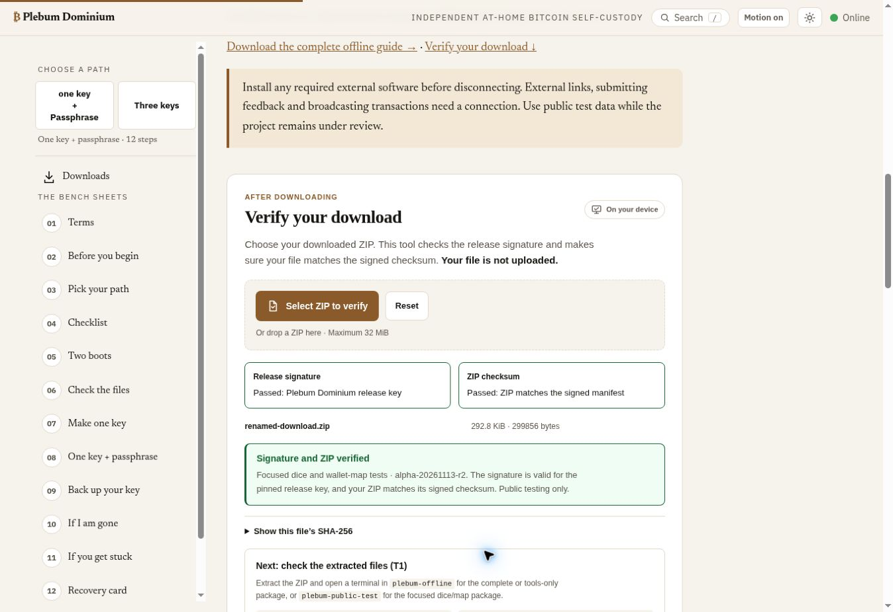
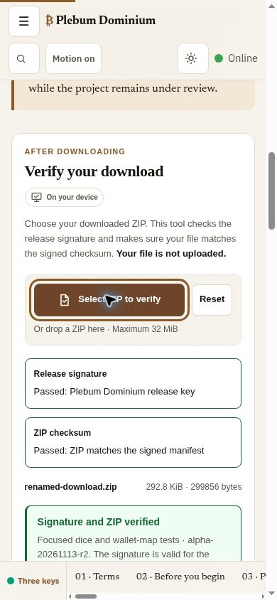

# Homepage signature verifier and signed r2 ZIPs

Prepared November 14, 2026 US Eastern / November 15 UTC. Staging draft only.

Selecting one ZIP now checks the author's detached manifest signature and the
ZIP's SHA-256. Homepage, Downloads and the self-contained verifier use the same
widget, catalog and scripts. Public key and signature files are preloaded; file
contents are never uploaded by the verifier. Sparrow/GnuPG instructions and the
full fingerprint are available in the expandable section.

## Signed material

- Public files: `docs/releases/20261113-r2/{manifest.txt,manifest.txt.asc,plebum-public.asc}`.
- Primary fingerprint: `B9286C4A7CFF722E191D2D7566FB7D9AB51E417E`.
- Signature time: **2026-11-15 01:49:38 UTC** (November 14, 20:49:38 EST).
- Manifest SHA-256: `7dd8eb16fc0c2dd4802ea6b1517c5642db51f217531be46567160deccc046cbb`.
- Signature SHA-256: `30493dba84fe2ffacf2c7452c6a72a1ee205d4d248983b0e47c9b230feb61e92`.
- Exactly three existing r2 ZIPs are authenticated. None were rebuilt or changed.
- The earlier 22-file signing preparation was not signed. The current 34-file
  site/verifier inventory is also unsigned and is explicitly labelled as such.
  It keeps checksumming the revised verifier without rewriting the old snapshot.
- No private key, passphrase or revocation certificate was obtained or published.

## Validation

- Independent GnuPG public-key-only verification returned `VALIDSIG` for the
  exact fingerprint above; all three archive hashes match the signed manifest.
- **32/32** verifier checks passed with real SHA-256 and the vendored OpenPGP.js
  implementation: actual ZIPs, renamed files, tampered ZIP/manifest/signature,
  wrong key, expired/future key dates, missing signature/library, altered catalog,
  legacy unsigned references, reset/cancel races and safe filename rendering.
- Chrome UI: desktop success for a renamed r2 ZIP; modified ZIP rejected;
  390px iframe layout and file selection passed; dark appearance inspected;
  self-contained page verified with its restrictive no-network CSP over HTTP.
- Cloud Browser blocks `file://` navigation. Opening the saved standalone file
  on physical Windows/Tails remains a follow-up; no such pass is claimed here.
- Shared-widget refresh is idempotent. All validation commands in
  `.github/workflows/offline-downloads.yml` passed locally, including archive
  consistency, preserved tool checks, release inventories, paths and site links.
- The exact cumulative live-source addendum is updated to record the intentional
  homepage/verifier changes. Unrecorded source drift and modified ZIPs still fail.
- Future archive assembly removes verifier widgets from homepage and Downloads;
  the verifier remains a separately saved companion, avoiding circular hashes.

## Limits

The page pins the full public-key fingerprint and fails closed on signature
errors. Its key and code are served by the same website, so independent identity
verification still requires a separately trusted fingerprint. Saved copies cannot
learn later revocations; an expired key or an incorrect device clock fails the
browser check. Legacy unsigned ZIPs receive an amber checksum-only result.
A verified release is still public alpha; it is not beta or real-wallet approval.

OpenPGP.js 6.3.2 is vendored unmodified, with npm integrity, file hashes, upstream
source archive and license texts recorded under `docs/assets/vendor/`.

